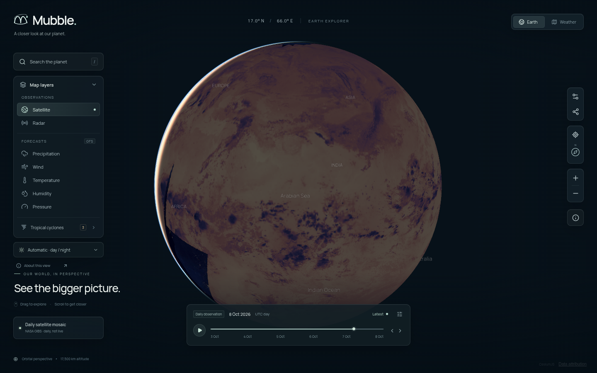
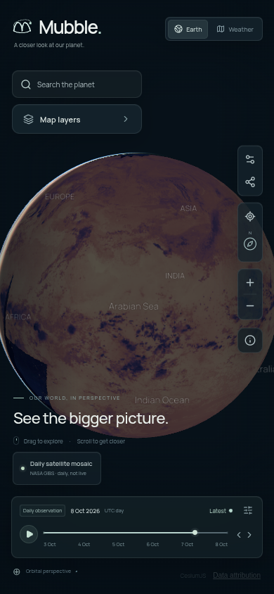

<p align="center">
  
</p>

# Mubble

**A closer look at our planet.**

Mubble is a weather and Earth exploration website built around an interactive 3D globe. Explore NASA satellite imagery, NOAA weather forecasts, regional radar, and official tropical cyclone advisories through a responsive interface with a distinctive orbital M identity.



## What you can explore

- Rotate the spherical Earth, zoom into regions, search places, and select coordinates directly on the globe.
- View genuine NASA GIBS daily satellite mosaics and night infrared imagery, with source dates and a manual or automatic day/night product selector.
- Play and scrub published satellite dates, radar history, and three-hour NOAA GFS forecasts through 72 hours.
- Display GFS temperature, humidity, pressure, accumulated precipitation, and wind. Wind particles follow actual model vectors.
- Open model-derived point conditions, hourly weather, and seven-day forecasts from Open-Meteo.
- Inspect NHC tropical cyclone advisories and published historical and forecast tracks for supported basins.
- Enable optional measured terrain, country boundaries, and historical night lights.
- Save places and preferences in your browser and share URLs that restore the selected map view.

Mubble includes mobile controls, keyboard navigation, reduced-motion support, and explicit provider outage states. Historical reference textures, observations, and forecasts are labeled separately.

This is the **0.1.0 development release**. The connected features work; the broader global coverage described in the project brief remains on the [roadmap](docs/ROADMAP.md).



## Run locally

Use **Node.js 24** and **Python 3.12** on Linux, macOS, or Windows through WSL. Exact tested versions are recorded in `.nvmrc` and `.python-version`. The current public data adapters do not require API keys.

```bash
git clone https://github.com/Tajlmao/Mubble.git
cd Mubble
bash scripts/setup.sh
npm run dev
```

The setup script installs the locked npm dependencies, prepares local Cesium assets, creates a copied-interpreter Python virtual environment, installs the pinned GRIB decoder dependencies, and builds the application. It works from any checkout location. The development server listens on port 3000 by default.

For production, after setup:

```bash
npm start
```

The server requires both Node.js and the Python `.venv` in the project directory. **GitHub Pages and static exports cannot run the weather API backend.** See [deployment instructions](docs/DEPLOYMENT.md) for hosting requirements and phone access.

Optional settings are documented in [.env.example](.env.example). Set `MUBBLE_SITE_URL` to the permanent public origin when deploying; temporary previews can derive their origin from trusted reverse-proxy headers.

## Data and coverage

| Source                                                                 | Connected data                                              | Interpretation                                                                                                                                    |
| ---------------------------------------------------------------------- | ----------------------------------------------------------- | ------------------------------------------------------------------------------------------------------------------------------------------------- |
| [NASA EOSDIS GIBS](https://www.earthdata.nasa.gov/data/tools/gibs)     | VIIRS/MODIS visible daily mosaics and night infrared        | Polar-orbiting observations grouped by acquisition day. A daily mosaic is not a simultaneous live global image. The latest day may be incomplete. |
| [NOAA/NCEP NOMADS](https://nomads.ncep.noaa.gov/)                      | GFS 1° global fields                                        | Numerical forecasts decoded from GRIB2. Actual cycle, valid time, and precipitation accumulation interval are reported.                           |
| [Open-Meteo](https://open-meteo.com/)                                  | Geocoding, point conditions, hourly and seven-day forecasts | Model-derived conditions. Data requires attribution. The free API tier is for noncommercial use.                                                  |
| [RainViewer](https://www.rainviewer.com/api.html)                      | Published regional radar history                            | Coverage depends on contributing radar networks. Missing imagery does not mean dry weather.                                                       |
| [NOAA NHC](https://www.nhc.noaa.gov/)                                  | Advisories and available ATCF tracks                        | Atlantic, eastern Pacific, and central Pacific. Agency classifications and one-minute wind conventions are retained.                              |
| [Mapzen elevation tiles](https://registry.opendata.aws/terrain-tiles/) | Optional Terrarium elevation                                | Measured terrain from contributing datasets. An unavailable source restores the reference ellipsoid.                                              |
| NASA / Natural Earth                                                   | Bundled reference composites and boundaries                 | Historical NASA Blue Marble and 2012 VIIRS night lights; public-domain country boundaries. These are not current weather.                         |

GOES, Himawari, Meteosat, worldwide cyclone agencies, uncertainty cones, water-vapor imagery, and classified fog/severe-storm detection are not connected yet. Mubble does not substitute invented observations for unavailable products.

## Technology and structure

Next.js 16, React 19, strict TypeScript, CesiumJS, Manrope, and a Python/ecCodes GRIB2 decoder.

```text
app/                Pages, metadata, and server API routes
components/         Globe, explorer controls, branding, and forecasts
lib/                Provider requests, caches, data types, and weather math
public/earth/       Reference textures, boundaries, and terrain attribution
public/licenses/    Licenses served with the application
scripts/            Setup, Cesium preparation, GRIB decoding, and screenshots
tests/              Unit and browser tests
docs/               Architecture, API, deployment, roadmap, and screenshots
.github/            Continuous integration and contribution templates
```

`public/cesium/` is generated by `npm ci` and is intentionally excluded from Git. Python dependencies, build output, caches, credentials, and browser test artifacts are also excluded.

Read the [architecture guide](docs/ARCHITECTURE.md) and [API reference](docs/API.md) for implementation details.

## Verify changes

```bash
npm run lint
npm run typecheck
npm test
npm run build
```

Browser tests require a running server and Chromium:

```bash
# Install Playwright's browser, or set MUBBLE_CHROMIUM_PATH to system Chromium.
npx playwright install chromium
npm run test:e2e
```

Set `MUBBLE_TEST_URL` to test an existing production or preview server. System Chromium in the managed cloud environment can be selected with `MUBBLE_CHROMIUM_PATH=/usr/bin/chromium`. Run `npm run screenshots` against that server to refresh the README images.

Nine unit tests cover forecast-cycle boundaries, longitude wrapping, missing vectors, published timestamps, coordinates, share links, cyclone normalization, and unit/color conversion. Four browser tests cover branding, actual globe navigation, persistent settings, live search/forecasts, satellite scrubbing, GFS/wind rendering, and mobile outage behavior. Browser tests that use external providers can fail during provider outages; mocked failures are confined to tests.

GitHub CI runs lint, type checking, the unit suite, Python dependency checks, a production build, and server readiness checks. Live provider/browser checks are documented separately from these deterministic CI checks.

## Contributing and reporting issues

See [CONTRIBUTING.md](CONTRIBUTING.md) for development conventions, [SECURITY.md](SECURITY.md) for private vulnerability reporting, and [CHANGELOG.md](CHANGELOG.md) for release notes. Report reproducible bugs or propose integrations through [GitHub issues](https://github.com/Tajlmao/Mubble/issues).

## License and attribution

Mubble's original code and documentation are released under the [MIT License](LICENSE). Third-party fonts, libraries, imagery, and provider data retain their own terms; the MIT license does not relicense those materials or grant rights to third-party trademarks.

See [third-party notices](THIRD_PARTY_NOTICES.md), [bundled reference image provenance](public/earth/SOURCES.md), and [terrain attribution](public/earth/terrain-attribution.md). Commercial hosting requires terms and licensing appropriate to each provider, including Open-Meteo's commercial API terms.
